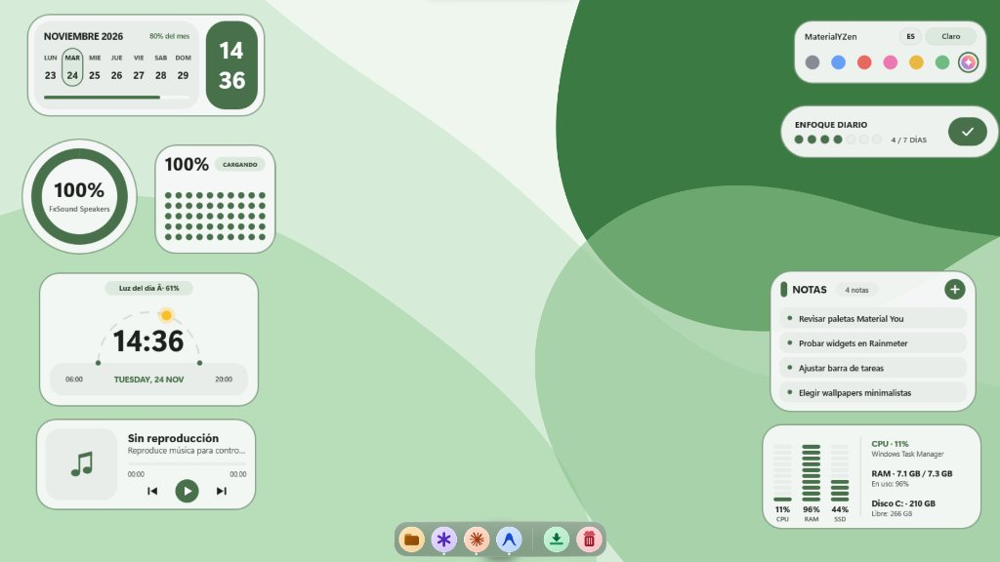
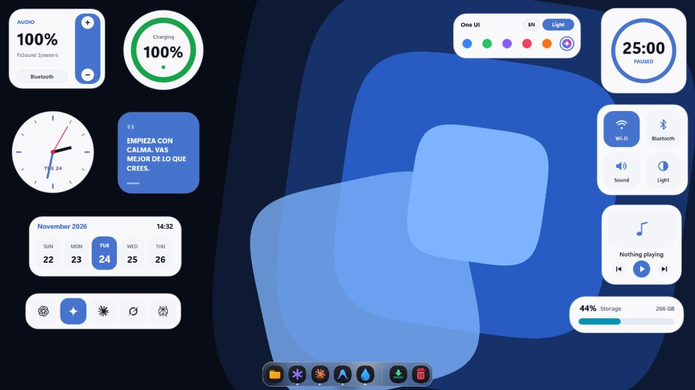
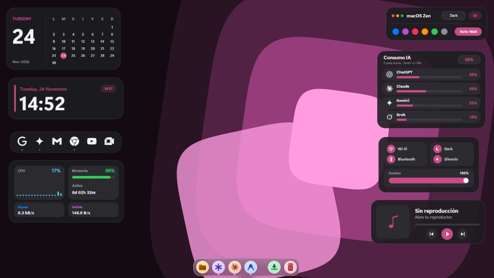

# Veyra-Dots

[English](README.md) | **Español**

Colección minimalista y modular de **dotfiles para Windows 11**, diseñada para personalizar el escritorio, el dock y el navegador por estilos visuales coherentes — **sin software pesado ni plugins `.dll` externos de Rainmeter**.

---

## Showcase

> Teaser animado interactivo a 60fps estilo Material 3 Expressive (ES / EN, exportable en 16:9 y 9:16): abre [`showcase/teaser.html`](showcase/teaser.html) en cualquier navegador Chromium.

### Material You (Oscuro y Claro)
| Ámbar — Oscuro | Ámbar — Claro |
| :---: | :---: |
|  |  |
| **Salvia — Oscuro** | **Salvia — Claro** |
|  |  |

### Samsung One UI 7 / 8 (OLED Oscuro y Pure Snow)
| Azul — OLED Oscuro | Azul — Pure Snow Claro |
| :---: | :---: |
|  |  |
| **Coral — OLED Oscuro** | **Coral — Pure Snow Claro** |
|  |  |

### macOS Sonoma / Sequoia
| Grafito — Oscuro | Grafito — Claro |
| :---: | :---: |
|  |  |
| **Magenta — Auto Wall Oscuro** | **Magenta — Auto Wall Claro** |
|  |  |

---

## Temáticas y Componentes

| Estilo | Carpeta | Estado | Componentes incluidos |
| :--- | :--- | :--- | :--- |
| **Material You** | [`themes/material-you/`](themes/material-you/README.md) | **Disponible (v2)** | **44 widgets Rainmeter** (Oscuro/Claro, ES/EN, 6 paletas + Auto Wallpaper, subsección **`ProHub`**), **Stylus v4.2.1** (Dark & Light, 7 paletas), **23 wallpapers**, **40 iconos Pastel Tonal** (PNG + ICO) y extensión recomendada **Mynt New Tab** |
| **One UI** | [`themes/one-ui/`](themes/one-ui/README.md) | **Disponible (v2)** | **28 widgets Rainmeter (`OneUIZen`)** en OLED Dark / Pure Snow Light + 5 acentos Samsung + Auto Wallpaper + Good Lock Retro Cassette, Smart Stack, **`ProHub`** y **80 iconos One UI** (`oneui-vibrant` + `oneui-dark`) |
| **macOS** | [`themes/macos/`](themes/macos/README.md) | **Disponible (v2)** | **28 widgets Rainmeter (`MacOSZen`)** estilo Sonoma/Sequoia: Menu Bar, Control Center, StandBy Clock, Dynamic Notch Hub, iStat Hub, About Storage, Power Menu, Activity Rings, 6 acentos Apple HIG + **`ProHub`** |
| **Glass / Mica** | `themes/glass/` | Planeado | Transparencias esmeriladas nativas de Windows 11 |
| **Nothing OS** | `themes/nothing/` | Planeado | Estética matricial de alto contraste |

---

## Capas del escritorio y herramientas empleadas

1. **Escritorio (Rainmeter):** 100 widgets vectoriales y modulares en `themes/<estilo>/rainmeter/`, instalados en un clic **sin `.dll` de terceros**.
2. **Dock ([Muelle](https://github.com/crafter-station/Muelle)):** Todas las configuraciones emplean **[Muelle](https://github.com/crafter-station/Muelle)** como dock ligero estilo macOS para Windows 11. Veyra-Dots incluye un aplicador seguro y reversible en 1 clic (`scripts/apply-muelle-icons.ps1`) con copia de seguridad y restauración automática.
3. **Packs de iconos de código libre (120 iconos — PNG 256×256 e ICO multirresolución):** Desarrollados a partir de la base de siluetas de **[Graphite-Elegance](https://github.com/Acourd/Graphite-Elegance)** y adaptados a cada estilo:
   - **Material You Pastel Tonal (`40 iconos`):** `themes/material-you/icons/m3-pastel/`
   - **One UI Vibrant (`40 iconos`):** `themes/one-ui/icons/oneui-vibrant/`
   - **One UI OLED Dark (`40 iconos`):** `themes/one-ui/icons/oneui-dark/`
4. **Navegador (Stylus v4.2.1 + Nueva Pestaña):**
   - Estilos web unificados (Modo Oscuro y Modo Claro) en `themes/material-you/stylus/` para Google, YouTube, Reddit, GitHub, WhatsApp Web, Linear, Wikipedia, X, Twitch y toda la suite de IA (ChatGPT, Gemini, Claude, Grok, Perplexity, DeepSeek, AI Studio y NotebookLM).
   - Complementado con **[Mynt — Material You New Tab](https://chromewebstore.google.com/detail/mynt-material-you-new-tab/jjpokbgpiljgndebfoljdeihhkpcpfgl)** en Chrome Web Store.
5. **Fondos de Pantalla (`wallpapers/`):** Colecciones curadas acordes a cada paleta.

### Vista previa de los packs de iconos

| Material You — Pastel Tonal (40 iconos) | One UI — Vibrant (40 iconos) | One UI — OLED Dark (40 iconos) |
| :---: | :---: | :---: |
|  |  |  |

---

## Estructura del repositorio

```text
Veyra-Dots/
├── README.md                    # Documentación en inglés
├── README.es.md                 # Documentación en español
├── showcase/                    # 12 capturas reales + teaser animado 60fps (ES/EN)
├── scripts/
│   ├── install-rainmeter.ps1    # Instalador 1-clic de cualquier estilo (o -Theme all)
│   └── apply-muelle-icons.ps1   # Aplicador 1-clic reversible de iconos para Muelle
└── themes/
    ├── material-you/            # 44 widgets, Stylus v4.2.1, 23 wallpapers, 40 iconos Pastel
    ├── one-ui/                  # 28 widgets, 80 iconos One UI (Vibrant + OLED Dark)
    ├── macos/                   # 28 widgets (Sonoma / Sequoia)
    ├── glass/
    └── nothing/
```

---

## Instalación rápida

```powershell
# 1. Clona el repositorio
git clone https://github.com/Acourd/Veyra-Dots.git
cd Veyra-Dots

# 2. Instala los widgets de Rainmeter (elige: material-you, one-ui, macos o all)
.\scripts\install-rainmeter.ps1 -Theme material-you
# O instala las 3 suites (100 widgets) de una vez:
.\scripts\install-rainmeter.ps1 -Theme all

# 3. (Opcional) Aplica los iconos personalizados en el dock Muelle (con respaldo automático; -Scale 1.05 por defecto, ajustable 0.90–1.08)
.\scripts\apply-muelle-icons.ps1 -Theme material-you
.\scripts\apply-muelle-icons.ps1 -Theme one-ui -Variant vibrant
.\scripts\apply-muelle-icons.ps1 -Theme one-ui -Variant dark

# Restaura los iconos originales de Muelle cuando quieras:
.\scripts\apply-muelle-icons.ps1 -Restore
```

Para instalar **Stylus v4.2.1**, la extensión **Mynt** y consultar el catálogo completo de widgets de cada estilo, abre el README correspondiente dentro de `themes/`.

---

## Créditos y Licencia

- Base de iconos de código libre: **[Graphite-Elegance](https://github.com/Acourd/Graphite-Elegance)** de Acourd — los 120 iconos de Material You y One UI incluidos en Veyra-Dots fueron desarrollados gracias a este proyecto.
- Dock utilizado en todas las capturas: **[Muelle](https://github.com/crafter-station/Muelle)** de Crafter Station.
- Extensión de Nueva Pestaña: **[Mynt — Material You New Tab](https://chromewebstore.google.com/detail/mynt-material-you-new-tab/jjpokbgpiljgndebfoljdeihhkpcpfgl)**.
- Distribuido bajo licencia **MIT**.
