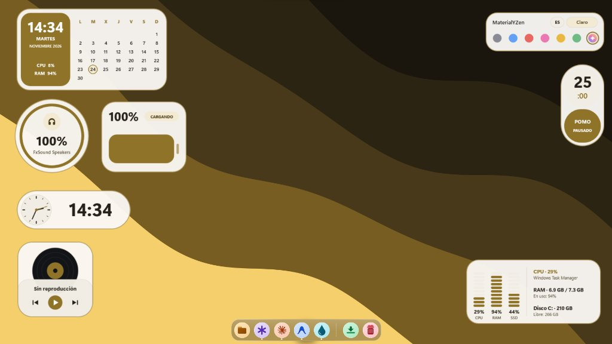
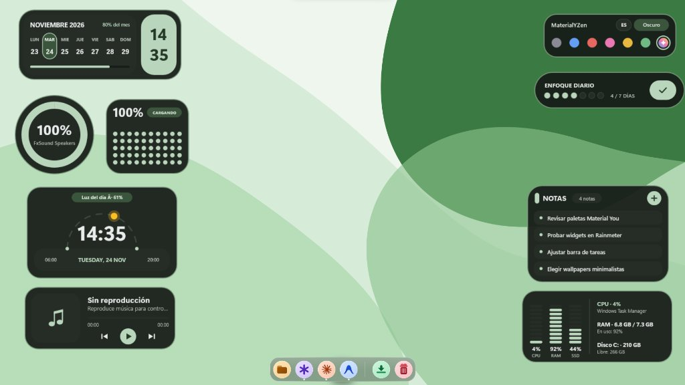
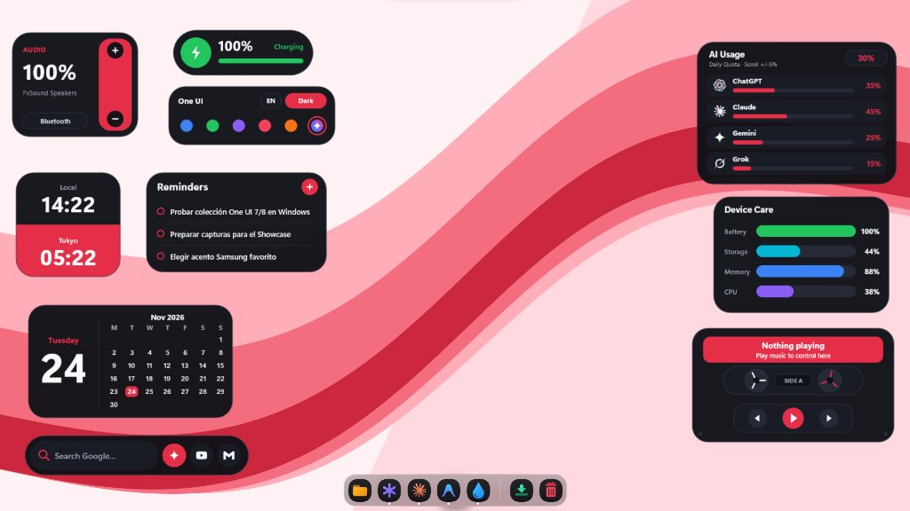
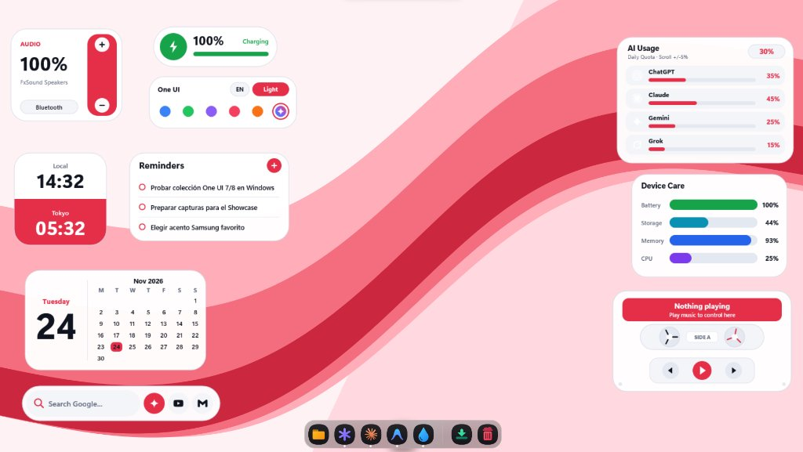
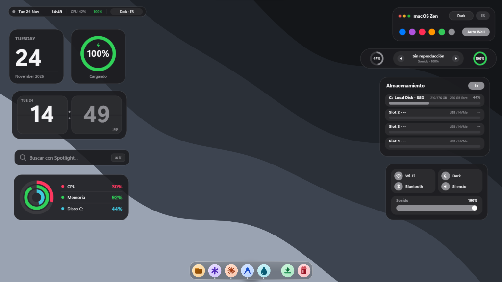
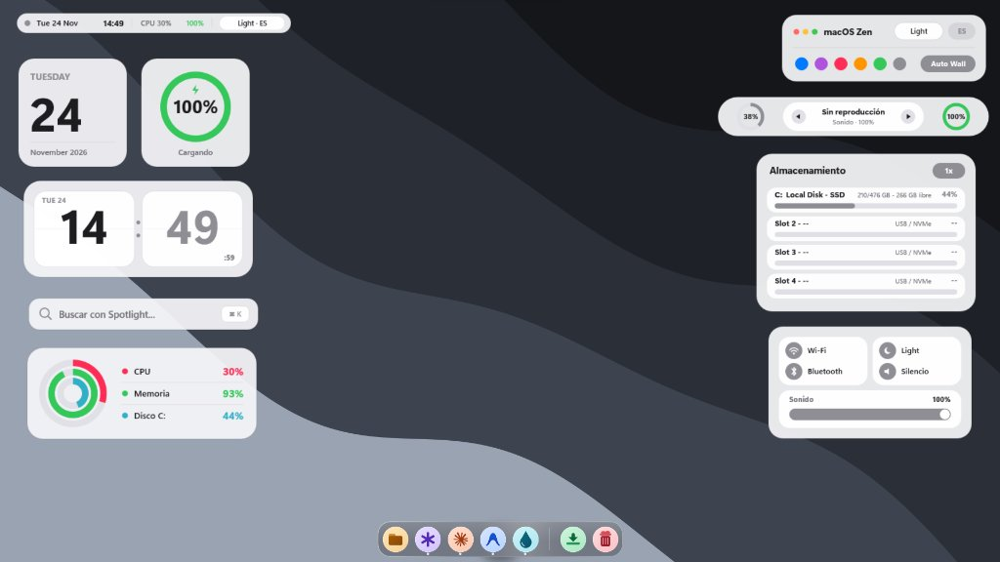
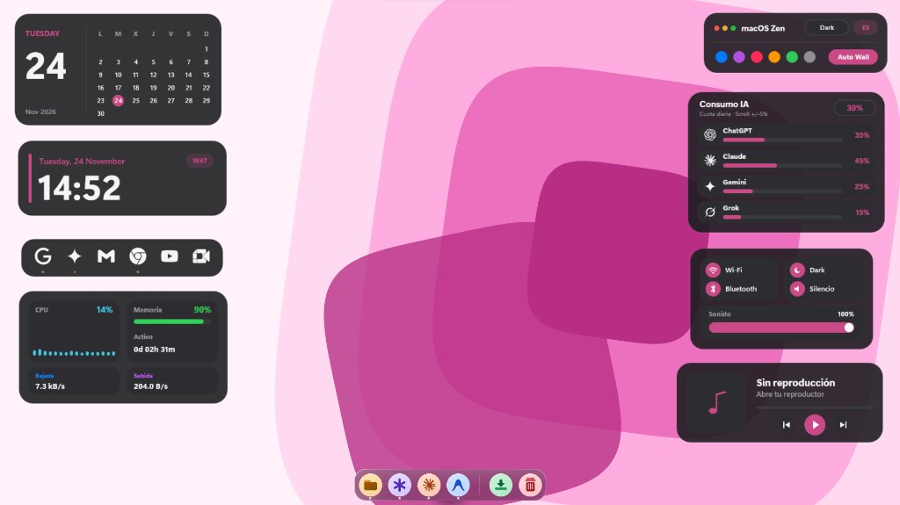
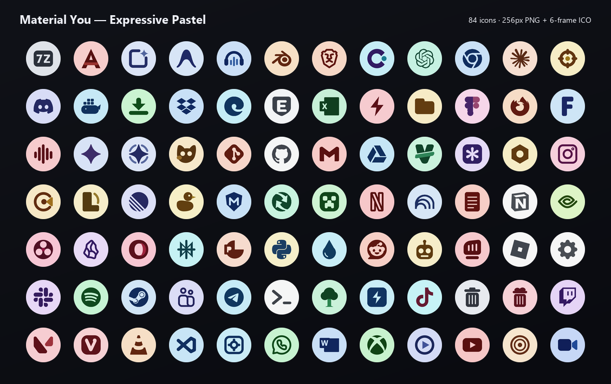
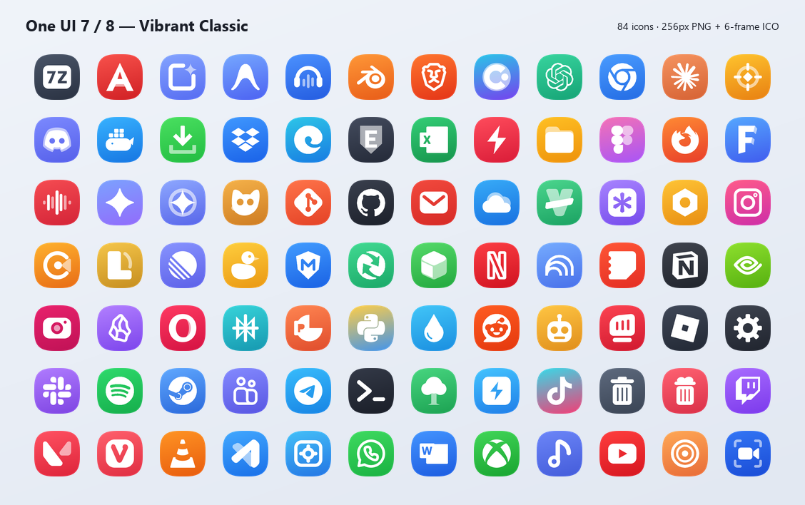
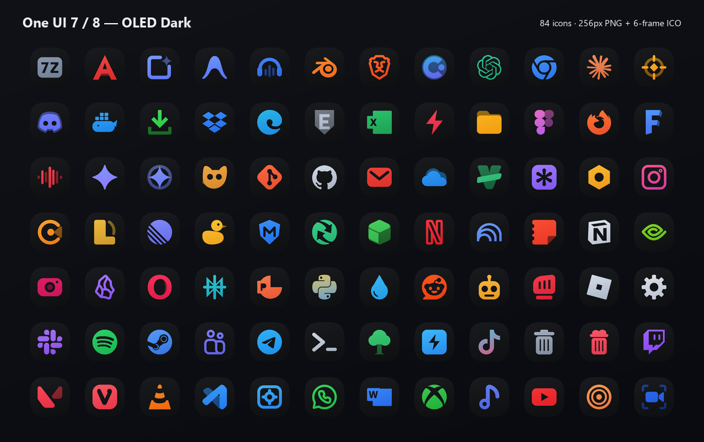

# Veyra-Dots

[English](README.md) | **Español**

Configuraciones de escritorio para Windows 11 — widgets de Rainmeter, iconos, fondos de pantalla y estilos web — organizadas por temática. Sin software pesado ni plugins `.dll` externos de Rainmeter.

---

## Showcase

https://github.com/user-attachments/assets/16a8c861-c458-4227-ac5a-5ca4d9b1222f

> Código fuente de la animación de arriba: [`showcase/teaser.html`](showcase/teaser.html) (ábrelo en cualquier navegador Chromium).

### Material You (Oscuro y Claro)
| Ámbar — Oscuro | Ámbar — Claro |
| :---: | :---: |
|  |  |
| **Salvia — Oscuro** | **Salvia — Claro** |
|  |  |

### Samsung One UI 7 / 8 (OLED Oscuro y Pure Snow)
| Azul — OLED Oscuro | Azul — Pure Snow Claro |
| :---: | :---: |
|  |  |
| **Coral — OLED Oscuro** | **Coral — Pure Snow Claro** |
|  |  |

### macOS Sonoma / Sequoia
| Grafito — Oscuro | Grafito — Claro |
| :---: | :---: |
|  |  |
| **Magenta — Auto Wall Oscuro** | **Magenta — Auto Wall Claro** |
|  |  |

---

## Temáticas

| Estilo | Carpeta | Estado | Qué incluye |
| :--- | :--- | :--- | :--- |
| **Material You** | [`themes/material-you/`](themes/material-you/README.md) | Listo (v2) | 44 widgets Rainmeter (Oscuro/Claro, ES/EN, 6 paletas + Auto Wallpaper), estilos web Stylus v4.2.1 (Oscuro y Claro), 23 wallpapers, 40 iconos Pastel (PNG + ICO) |
| **One UI** | [`themes/one-ui/`](themes/one-ui/README.md) | Listo (v2) | 28 widgets Rainmeter (`OneUIZen`, OLED Dark / Pure Snow Light, 5 acentos + Auto Wallpaper, Retro Cassette, Smart Stack), 36 wallpapers 4K, 80 iconos (`oneui-vibrant` + `oneui-dark`) |
| **macOS** | [`themes/macos/`](themes/macos/README.md) | Listo (v2) | 28 widgets Rainmeter (`MacOSZen`, Sonoma/Sequoia): Menu Bar, Control Center, StandBy Clock, Dynamic Notch Hub, iStat Hub, Almacenamiento, Menú de energía, Activity Rings, 6 acentos |
| **Glass / Mica** | `themes/glass/` | Planeado | Transparencias esmeriladas nativas de Windows 11 |
| **Nothing OS** | `themes/nothing/` | Planeado | Estética matricial de alto contraste |

### Herramientas e Iconos

- **Widgets:** 100 widgets de Rainmeter repartidos en las tres suites, sin `.dll` de terceros.
- **Dock:** Las capturas usan **[Muelle](https://github.com/crafter-station/Muelle)**. Tanto Muelle como el Escritorio y la Barra de Tareas nativa de Windows 11 tienen scripts reversibles en `scripts/`.
- **Navegador:** Estilos Stylus v4.2.1 (`themes/material-you/stylus/`) para Google, YouTube, Reddit, GitHub, WhatsApp Web, Linear, Wikipedia, X, Twitch y apps de IA (ChatGPT, Gemini, Claude, Grok, Perplexity, DeepSeek, AI Studio y NotebookLM), junto con **[Mynt New Tab](https://chromewebstore.google.com/detail/mynt-material-you-new-tab/jjpokbgpiljgndebfoljdeihhkpcpfgl)**.
- **Iconos (120 en total, PNG 256×256 + ICO multirresolución):** Basados en las siluetas de **[Graphite-Elegance](https://github.com/Acourd/Graphite-Elegance)**.

| Material You — Pastel Tonal (40) | One UI — Vibrant (40) | One UI — OLED Dark (40) |
| :---: | :---: | :---: |
|  |  |  |

---

## Instalación rápida

Elige el método que prefieras y haz clic para desplegar los pasos:

<details>
<summary><strong>Opción 1 — Paquetes <code>.rmskin</code> en doble clic (la más fácil, sin terminal)</strong></summary>

Descarga y haz doble clic sobre el paquete que quieras en [`releases/`](releases/):
- [`MaterialYZen-v2.rmskin`](releases/MaterialYZen-v2.rmskin) (44 widgets)
- [`OneUIZen-v2.rmskin`](releases/OneUIZen-v2.rmskin) (28 widgets)
- [`MacOSZen-v2.rmskin`](releases/MacOSZen-v2.rmskin) (28 widgets)

</details>

<details>
<summary><strong>Opción 2 — Instalación completa por PowerShell (Widgets + Iconos en Muelle)</strong></summary>

```powershell
# 1. Clona el repositorio
git clone https://github.com/Acourd/Veyra-Dots.git
cd Veyra-Dots

# 2. Instala los widgets de Rainmeter (material-you, one-ui, macos o all)
.\scripts\install-rainmeter.ps1 -Theme material-you
# O instala las 3 suites (100 widgets) de una vez:
.\scripts\install-rainmeter.ps1 -Theme all

# 3. (Opcional) Aplica los iconos en el dock Muelle (con respaldo automático; -Scale 0.90–1.08, por defecto 1.05)
.\scripts\apply-muelle-icons.ps1 -Theme material-you
.\scripts\apply-muelle-icons.ps1 -Theme one-ui -Variant vibrant
.\scripts\apply-muelle-icons.ps1 -Theme one-ui -Variant dark

# Restaura los iconos originales de Muelle cuando quieras:
.\scripts\apply-muelle-icons.ps1 -Restore
```

</details>

<details>
<summary><strong>Opción 3 — Iconos para Escritorio y Barra de Tareas nativa de Windows 11 (sin Muelle)</strong></summary>

Aplica los packs `.ico` directamente a tus accesos directos del Escritorio y las apps fijadas en la barra de tareas de Windows. Guarda copia de seguridad automática en `%LOCALAPPDATA%\VeyraDots\` para revertir cuando quieras.

```powershell
# Aplicar en Escritorio y Barra de Tareas (-Scope All | Desktop | Taskbar)
.\scripts\apply-windows-icons.ps1 -Theme material-you -RestartExplorer
.\scripts\apply-windows-icons.ps1 -Theme one-ui -Variant dark -RestartExplorer
.\scripts\apply-windows-icons.ps1 -Theme one-ui -Variant vibrant -Scope Taskbar -RestartExplorer

# Restaurar los iconos originales de Windows cuando quieras:
.\scripts\apply-windows-icons.ps1 -Restore -RestartExplorer
```

</details>

Para instalar **Stylus v4.2.1**, **Mynt New Tab** o ver el catálogo completo de widgets de cada estilo, abre el README correspondiente dentro de `themes/`.

---

## Créditos, Aviso Legal y Licencia

- Base de siluetas de iconos: **[Graphite-Elegance](https://github.com/Acourd/Graphite-Elegance)** de Acourd.
- Dock en las capturas: **[Muelle](https://github.com/crafter-station/Muelle)** de Crafter Station.
- Extensión de Nueva Pestaña: **[Mynt — Material You New Tab](https://chromewebstore.google.com/detail/mynt-material-you-new-tab/jjpokbgpiljgndebfoljdeihhkpcpfgl)**.
- **Aviso de Marcas Registradas:** Veyra-Dots es un proyecto independiente, gratuito y de código abierto sin fines de lucro. **No** está afiliado, patrocinado ni respaldado por Google LLC, Samsung Electronics, Apple Inc. ni por los creadores de las aplicaciones o videojuegos representados en los packs de iconos opcionales. Todos los nombres de productos, marcas comerciales y logotipos pertenecen a sus respectivos propietarios y se utilizan únicamente con fines identificativos en el escritorio del usuario.
- Licencia: **MIT**.
