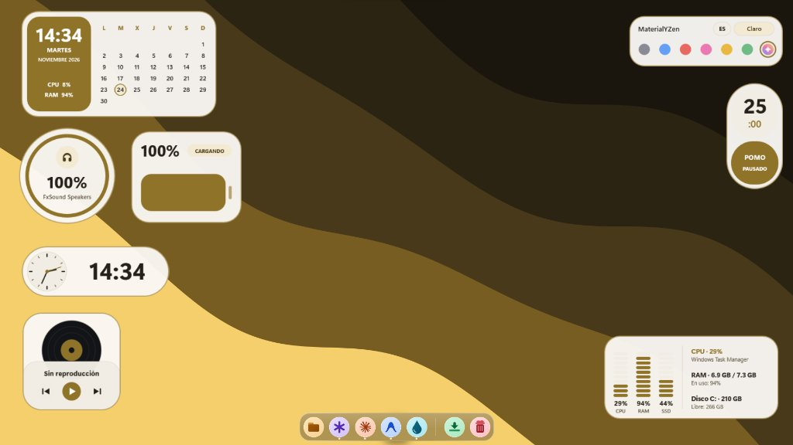
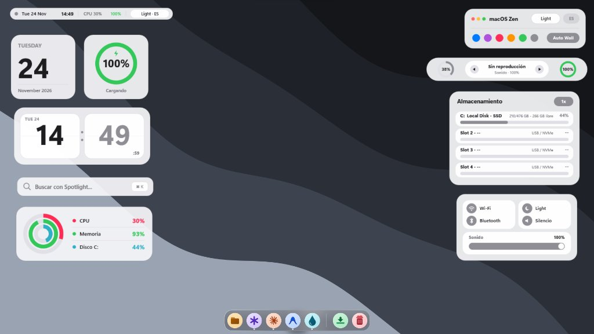

# Veyra-Dots

**English** | [Español](README.es.md)

Windows 11 desktop setups — Rainmeter widgets, custom icons, wallpapers, and browser styles — grouped by visual theme. No bloatware and no third-party Rainmeter `.dll` plugins.

---

## Showcase

https://github.com/user-attachments/assets/689d621e-6450-416e-b4cd-c3631081fab4

> Source for the animation above: [`showcase/teaser.html`](showcase/teaser.html) (open locally in any Chromium browser).

### Material You (Dark & Light)
| Amber — Dark | Amber — Light |
| :---: | :---: |
|  |  |
| **Sage — Dark** | **Sage — Light** |
|  |  |

### Samsung One UI 7 / 8 (OLED Dark & Pure Snow)
| Blue — OLED Dark | Blue — Pure Snow Light |
| :---: | :---: |
|  |  |
| **Coral — OLED Dark** | **Coral — Pure Snow Light** |
|  |  |

### macOS Sonoma / Sequoia
| Graphite — Dark | Graphite — Light |
| :---: | :---: |
|  |  |
| **Magenta — Auto Wall Dark** | **Magenta — Auto Wall Light** |
|  |  |

---

## Themes

| Theme | Folder | Status | What's inside |
| :--- | :--- | :--- | :--- |
| **Material You** | [`themes/material-you/`](themes/material-you/README.md) | Ready (v2) | 44 Rainmeter widgets (Dark/Light, EN/ES, 6 palettes + Auto Wallpaper), Stylus v4.2.1 web styles (Dark & Light), 23 wallpapers, 40 Pastel icons (PNG + ICO) |
| **One UI** | [`themes/one-ui/`](themes/one-ui/README.md) | Ready (v2) | 28 Rainmeter widgets (`OneUIZen`, OLED Dark / Pure Snow Light, 5 accents + Auto Wallpaper, Retro Cassette, Smart Stack), 36 4K wallpapers, 80 icons (`oneui-vibrant` + `oneui-dark`) |
| **macOS** | [`themes/macos/`](themes/macos/README.md) | Ready (v2) | 28 Rainmeter widgets (`MacOSZen`, Sonoma/Sequoia): Menu Bar, Control Center, StandBy Clock, Dynamic Notch Hub, iStat Hub, Storage, Power Menu, Activity Rings, 6 accents |
| **Glass / Mica** | `themes/glass/` | Planned | Windows 11 frosted translucency |
| **Nothing OS** | `themes/nothing/` | Planned | High-contrast dot-matrix style |

### Companion Tools & Icons

- **Widgets:** 100 Rainmeter widgets across the three suites, zero external `.dll` files.
- **Dock:** Screenshots use **[Muelle](https://github.com/crafter-station/Muelle)**. Both Muelle and the default Windows 11 Taskbar/Desktop have reversible icon scripts under `scripts/`.
- **Browser:** Stylus v4.2.1 userstyles (`themes/material-you/stylus/`) for Google, YouTube, Reddit, GitHub, WhatsApp Web, Linear, Wikipedia, X, Twitch, and AI apps (ChatGPT, Gemini, Claude, Grok, Perplexity, DeepSeek, AI Studio, NotebookLM), paired with **[Mynt New Tab](https://chromewebstore.google.com/detail/mynt-material-you-new-tab/jjpokbgpiljgndebfoljdeihhkpcpfgl)**.
- **Icons (120 total, PNG 256×256 + multi-res ICO):** Built on **[Graphite-Elegance](https://github.com/Acourd/Graphite-Elegance)** silhouettes.

| Material You — Pastel Tonal (40) | One UI — Vibrant (40) | One UI — OLED Dark (40) |
| :---: | :---: | :---: |
|  |  |  |

---

## Quick Start

Pick the method that fits your setup — click any option to expand:

<details>
<summary><strong>Option 1 — Double-click <code>.rmskin</code> packages (easiest, no terminal)</strong></summary>

Download and double-click any Rainmeter package in [`releases/`](releases/):
- [`MaterialYZen-v2.rmskin`](releases/MaterialYZen-v2.rmskin) (44 widgets)
- [`OneUIZen-v2.rmskin`](releases/OneUIZen-v2.rmskin) (28 widgets)
- [`MacOSZen-v2.rmskin`](releases/MacOSZen-v2.rmskin) (28 widgets)

</details>

<details>
<summary><strong>Option 2 — Full setup via PowerShell (Widgets + Muelle dock icons)</strong></summary>

```powershell
# 1. Clone the repo
git clone https://github.com/Acourd/Veyra-Dots.git
cd Veyra-Dots

# 2. Install Rainmeter widgets (material-you, one-ui, macos, or all)
.\scripts\install-rainmeter.ps1 -Theme material-you
# Or install all 3 suites (100 widgets) at once:
.\scripts\install-rainmeter.ps1 -Theme all

# 3. (Optional) Apply custom icons to Muelle dock (auto-backs up originals; -Scale 0.90–1.08, default 1.05)
.\scripts\apply-muelle-icons.ps1 -Theme material-you
.\scripts\apply-muelle-icons.ps1 -Theme one-ui -Variant vibrant
.\scripts\apply-muelle-icons.ps1 -Theme one-ui -Variant dark

# Restore original Muelle icons anytime:
.\scripts\apply-muelle-icons.ps1 -Restore
```

</details>

<details>
<summary><strong>Option 3 — Default Windows 11 Desktop & Taskbar icons (no Muelle needed)</strong></summary>

Applies the `.ico` packs directly to Desktop shortcuts and pinned Windows 11 Taskbar apps. Originals are backed up automatically to `%LOCALAPPDATA%\VeyraDots\` so you can revert anytime.

```powershell
# Apply to Desktop & pinned Taskbar (-Scope All | Desktop | Taskbar)
.\scripts\apply-windows-icons.ps1 -Theme material-you -RestartExplorer
.\scripts\apply-windows-icons.ps1 -Theme one-ui -Variant dark -RestartExplorer
.\scripts\apply-windows-icons.ps1 -Theme one-ui -Variant vibrant -Scope Taskbar -RestartExplorer

# Restore original Windows shortcut icons anytime:
.\scripts\apply-windows-icons.ps1 -Restore -RestartExplorer
```

</details>

For **Stylus v4.2.1**, **Mynt New Tab**, and the full widget list for each theme, check the README inside each folder under `themes/`.

---

## Credits, Disclaimer & License

- Icon silhouette base: **[Graphite-Elegance](https://github.com/Acourd/Graphite-Elegance)** by Acourd.
- Dock in screenshots: **[Muelle](https://github.com/crafter-station/Muelle)** by Crafter Station.
- New Tab extension: **[Mynt — Material You New Tab](https://chromewebstore.google.com/detail/mynt-material-you-new-tab/jjpokbgpiljgndebfoljdeihhkpcpfgl)**.
- **Trademark Disclaimer:** Veyra-Dots is an independent, non-commercial, open-source project. It is **not** affiliated with, endorsed by, or sponsored by Google LLC, Samsung Electronics, Apple Inc., or any app/game publisher represented in the optional icon packs. All product names, trademarks, and logos belong to their respective owners and are used solely for nominative identification on the user's desktop.
- License: **MIT**.
