# Veyra-Dots

**English** | [Español](README.es.md)

A minimalist, modular collection of **Windows 11 dotfiles**, designed to transform your desktop, dock, and browser across cohesive visual themes — with **zero bloatware and zero external Rainmeter `.dll` plugins**.

---

## Showcase

> Interactive 60fps Material 3 Expressive motion teaser (EN / ES, 16:9 & 9:16 exportable): open [`showcase/teaser.html`](showcase/teaser.html) locally in any Chromium browser.

### Material You (Dark & Light)
| Amber — Dark | Amber — Light |
| :---: | :---: |
| 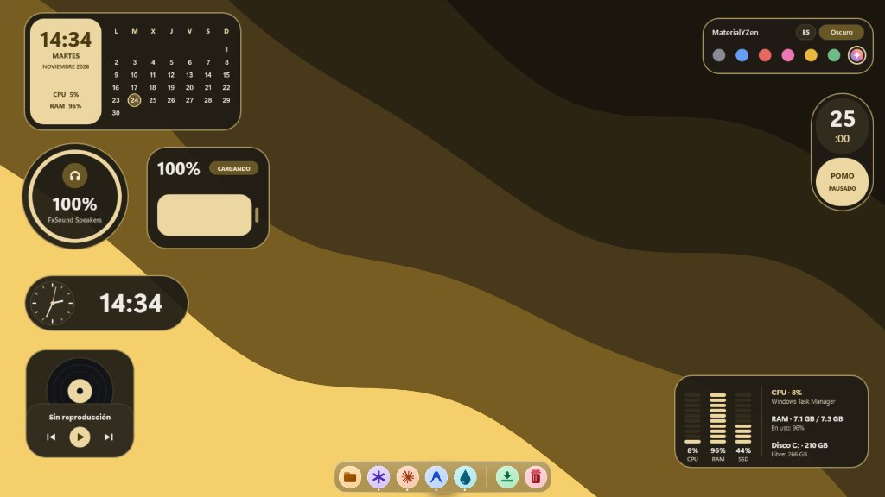 |  |
| **Sage — Dark** | **Sage — Light** |
| 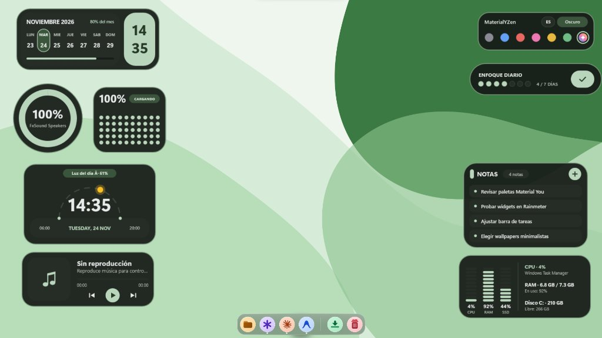 | 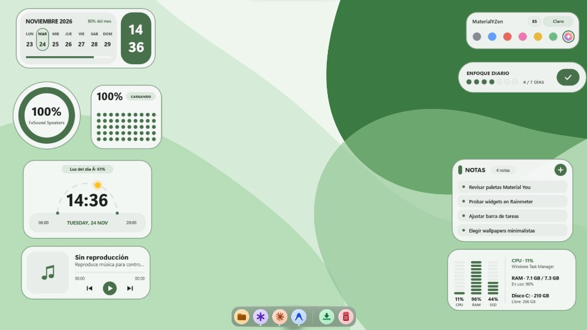 |

### Samsung One UI 7 / 8 (OLED Dark & Pure Snow)
| Blue — OLED Dark | Blue — Pure Snow Light |
| :---: | :---: |
| 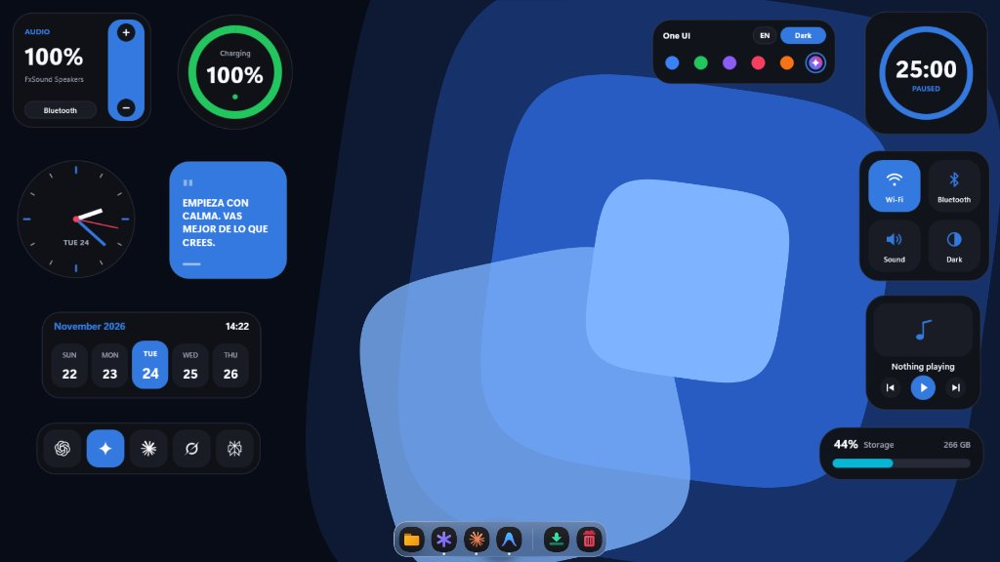 | 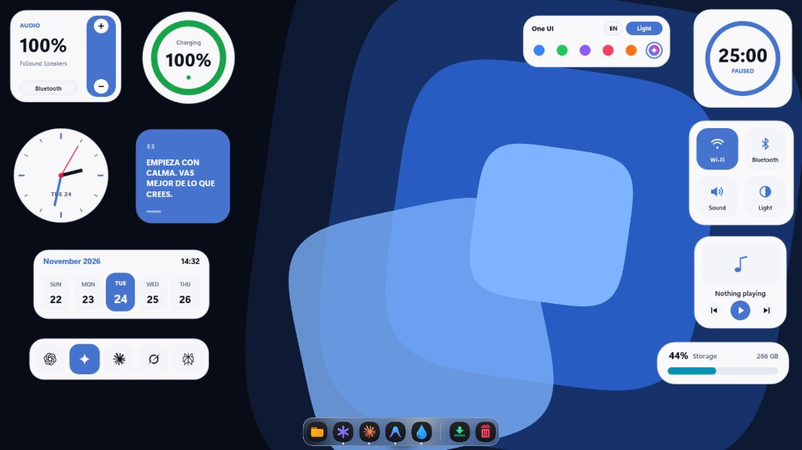 |
| **Coral — OLED Dark** | **Coral — Pure Snow Light** |
| 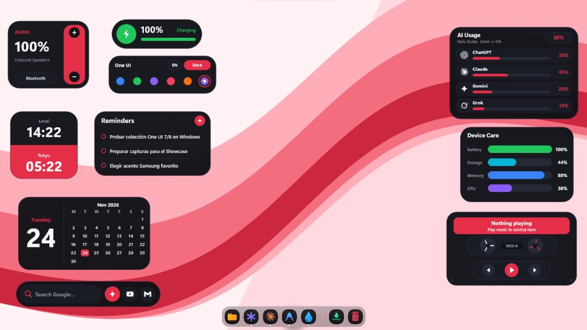 | 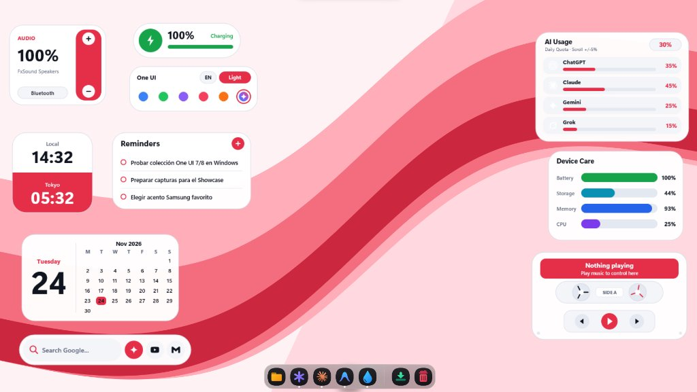 |

### macOS Sonoma / Sequoia
| Graphite — Dark | Graphite — Light |
| :---: | :---: |
| 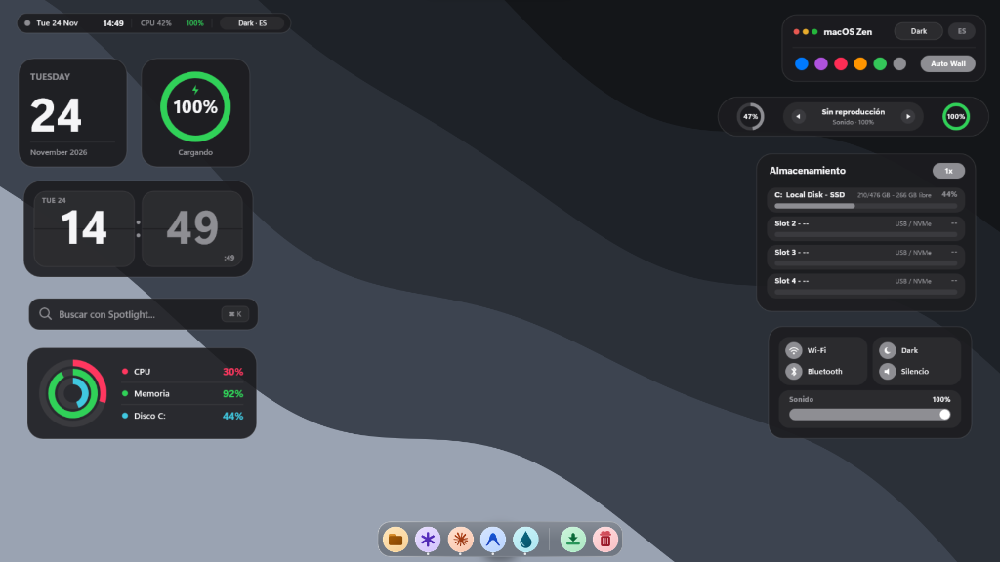 |  |
| **Magenta — Auto Wall Dark** | **Magenta — Auto Wall Light** |
| 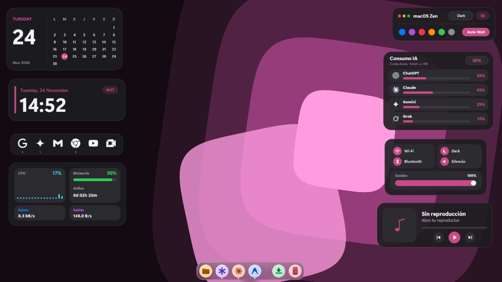 | 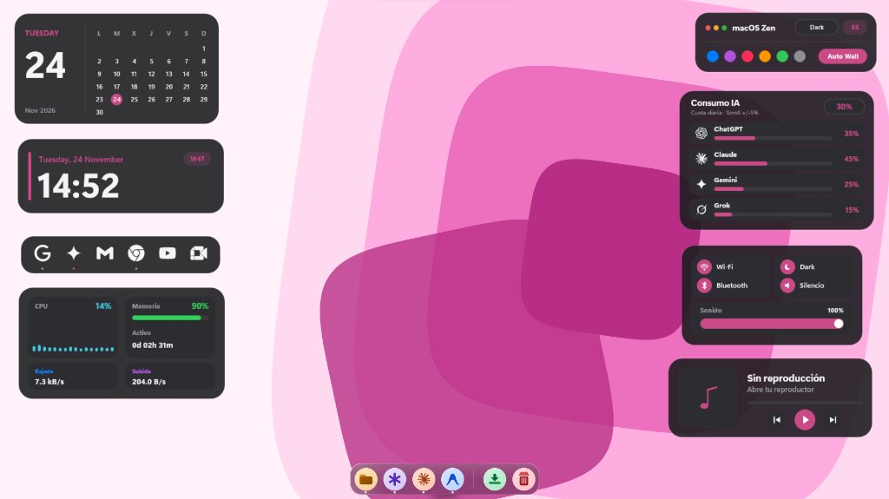 |

---

## Themes & Components

| Style | Folder | Status | Included Components |
| :--- | :--- | :--- | :--- |
| **Material You** | [`themes/material-you/`](themes/material-you/README.md) | **Available (v2)** | **44 Rainmeter widgets** (Dark/Light, EN/ES, 6 palettes + Auto Wallpaper, **`ProHub`**), **Stylus v4.2.1** (Dark & Light, 7 palettes), **23 wallpapers**, **40 Pastel Tonal icons** (PNG + ICO), and recommended **Mynt New Tab** |
| **One UI** | [`themes/one-ui/`](themes/one-ui/README.md) | **Available (v2)** | **28 Rainmeter widgets (`OneUIZen`)** in OLED Dark / Pure Snow Light + 5 Samsung accents + Auto Wallpaper + Good Lock Retro Cassette, Smart Stack, **`ProHub`**, and **80 One UI icons** (`oneui-vibrant` + `oneui-dark`) |
| **macOS** | [`themes/macos/`](themes/macos/README.md) | **Available (v2)** | **28 Rainmeter widgets (`MacOSZen`)** Sonoma/Sequoia style: Menu Bar, Control Center, StandBy Clock, Dynamic Notch Hub, iStat Hub, About Storage, Power Menu, Activity Rings, 6 Apple HIG accents + **`ProHub`** |
| **Glass / Mica** | `themes/glass/` | Planned | Native Windows 11 frosted translucency |
| **Nothing OS** | `themes/nothing/` | Planned | High-contrast dot-matrix aesthetic |

---

## Desktop Stack & Companion Tools

1. **Desktop Widgets (Rainmeter):** 100 modular vector widgets across `themes/<style>/rainmeter/`, installed in 1 click with **zero third-party `.dll` plugins**.
2. **Dock ([Muelle](https://github.com/crafter-station/Muelle)):** All setups use **[Muelle](https://github.com/crafter-station/Muelle)** as the lightweight macOS-style dock for Windows 11. Veyra-Dots includes a safe, reversible 1-click icon injector (`scripts/apply-muelle-icons.ps1`) with automatic backup and restore.
3. **Custom Icon Packs (120 icons — PNG 256×256 & multi-res ICO):**
   - **Material You Pastel Tonal (`40 icons`):** `themes/material-you/icons/m3-pastel/`
   - **One UI Vibrant (`40 icons`):** `themes/one-ui/icons/oneui-vibrant/`
   - **One UI OLED Dark (`40 icons`):** `themes/one-ui/icons/oneui-dark/`
4. **Browser (Stylus v4.2.1 + New Tab):**
   - Unified Dark & Light userstyles in `themes/material-you/stylus/` covering Google, YouTube, Reddit, GitHub, WhatsApp Web, Linear, Wikipedia, X, Twitch, and the full AI suite (ChatGPT, Gemini, Claude, Grok, Perplexity, DeepSeek, AI Studio, NotebookLM).
   - Paired with **[Mynt — Material You New Tab](https://chromewebstore.google.com/detail/mynt-material-you-new-tab/jjpokbgpiljgndebfoljdeihhkpcpfgl)** on Chrome Web Store.
5. **Wallpapers (`wallpapers/`):** Curated palettes designed to match every theme.

### Icon Pack Previews

| Material You — Pastel Tonal (40 icons) | One UI — Vibrant (40 icons) | One UI — OLED Dark (40 icons) |
| :---: | :---: | :---: |
| 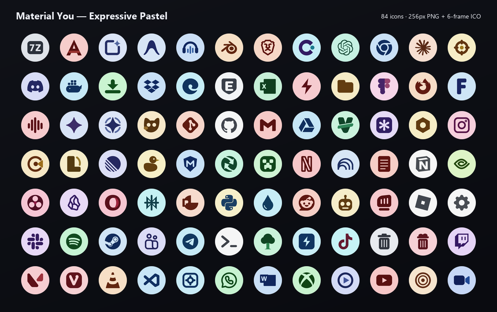 | 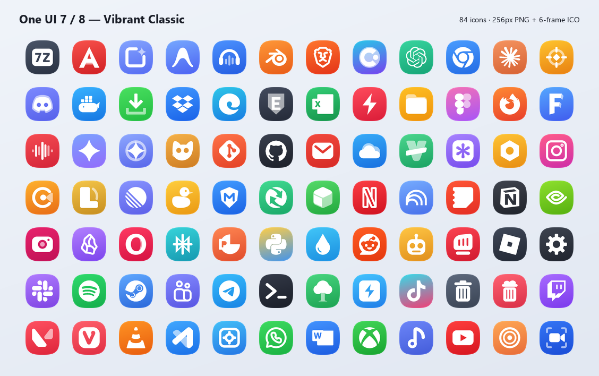 | 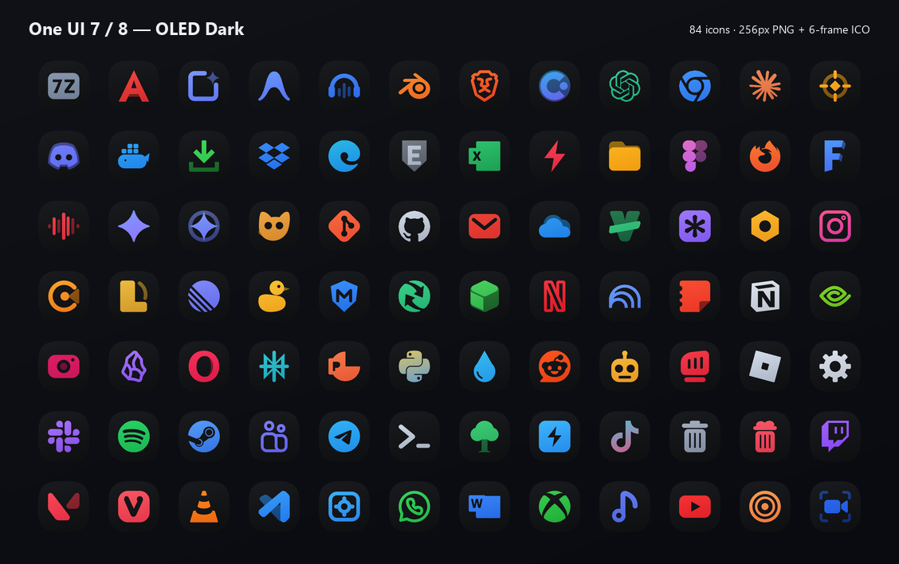 |

---

## Repository Structure

```text
Veyra-Dots/
├── README.md                    # English documentation
├── README.es.md                 # Spanish documentation
├── showcase/                    # 12 real screenshots + 60fps EN/ES motion teaser
├── scripts/
│   ├── install-rainmeter.ps1    # 1-click Rainmeter suite installer (-Theme all supported)
│   └── apply-muelle-icons.ps1   # 1-click reversible icon pack injector for Muelle dock
└── themes/
    ├── material-you/            # 44 widgets, Stylus v4.2.1, 23 wallpapers, 40 Pastel icons
    ├── one-ui/                  # 28 widgets, 80 One UI icons (Vibrant + OLED Dark)
    ├── macos/                   # 28 widgets (Sonoma / Sequoia)
    ├── glass/
    └── nothing/
```

---

## Quick Start

```powershell
# 1. Clone the repository
git clone https://github.com/Acourd/Veyra-Dots.git
cd Veyra-Dots

# 2. Install Rainmeter widgets (choose: material-you, one-ui, macos, or all)
.\scripts\install-rainmeter.ps1 -Theme material-you
# Or install all 3 suites (100 widgets) at once:
.\scripts\install-rainmeter.ps1 -Theme all

# 3. (Optional) Apply custom icons to Muelle dock (auto-backs up originals; default -Scale 1.05, tunable 0.90–1.08)
.\scripts\apply-muelle-icons.ps1 -Theme material-you
.\scripts\apply-muelle-icons.ps1 -Theme one-ui -Variant vibrant
.\scripts\apply-muelle-icons.ps1 -Theme one-ui -Variant dark

# Restore original Muelle icons anytime:
.\scripts\apply-muelle-icons.ps1 -Restore
```

To install **Stylus v4.2.1**, **Mynt New Tab**, or browse the full widget catalog for each suite, open the corresponding README inside `themes/`.

---

## Credits & License

- Dock featured in all screenshots: **[Muelle](https://github.com/crafter-station/Muelle)** by Crafter Station.
- New Tab extension: **[Mynt — Material You New Tab](https://chromewebstore.google.com/detail/mynt-material-you-new-tab/jjpokbgpiljgndebfoljdeihhkpcpfgl)**.
- Distributed under the **MIT** License.
