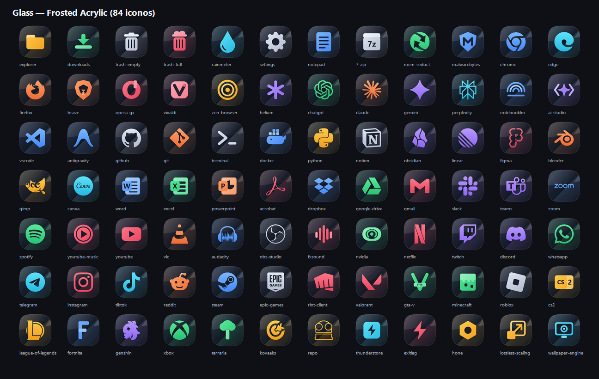

# Tema: Glass / Mica (Windows 11 Frosted Acrylic Style)

Suite nativa de Rainmeter sin plugins externos inspirada en **Windows 11 Acrylic & Mica**: tarjetas translúcidas con brillo especular superior, modos **Smoked Glass (Oscuro)** / **Frosted Ice (Claro)** y **6 acentos Fluent + Auto Wallpaper**.

## Widgets incluidos (`GlassZen`, 24 widgets)

| Categoría | Widgets |
| :--- | :--- |
| **ThemeSwitcher (1)** | `GlassSwitcher.ini` — Alterna en 1 clic entre **Oscuro (Smoked) / Claro (Frosted)**, **ES / EN**, **6 acentos Fluent** (`IceBlue`, `MintGlass`, `Lavender`, `Sunset`, `Rose`, `Graphite`) y **Auto Wallpaper**. |
| **ProHub (3) — Hardware & IA** | `GlassBluetoothHub.ini` (dispositivos Bluetooth en vivo + batería), `GlassAIUsageHub.ini` (cuota diaria de ChatGPT, Claude, Gemini y Grok con scroll) y `GlassStorageVault.ini` (bóveda SSD/NVMe/USB). |
| **Clock (5)** | `GlassClockHero.ini`, `GlassFlipClock.ini`, `GlassAnalog.ini`, `GlassWorldClock.ini` y `GlassSolarArc.ini` (arco orbital solar/lunar). |
| **Calendar (3)** | `GlassCalendar.ini` (matriz 6×7), `GlassWeekStrip.ini` (tira semanal de 5 días) y `GlassCountdown.ini` (cuenta regresiva configurable). |
| **System (3)** | `GlassSystemTiles.ini` (cuadrícula 2×2 CPU/RAM/C:/Bat), `GlassNetworkPulse.ini` (sparkline de red en vivo) y `GlassStorageBar.ini`. |
| **Battery & Audio (3)** | `GlassBatteryPill.ini`, `GlassBatteryRing.ini` y `GlassAudioCard.ini` (volumen táctil y silencio). |
| **Music & Focus (3)** | `GlassMusicCard.ini`, `GlassMusicMini.ini` y `GlassFocus.ini` (Pomodoro circular de 25 min). |
| **Search & Notes (3)** | `GlassLauncher.ini` (búsqueda web), `GlassAiDock.ini` (5 asistentes de IA HD) y `GlassReminders.ini` (lista interactiva con botón `+`). |

## Pack de iconos (`icons/glass-frosted/`, 84 iconos)

Incluye **84 iconos** translúcidos estilo **Frosted Acrylic** exportados en **PNG (256×256)** e **ICO multirresolución (16–256px)** para Escritorio, Barra de Tareas y **Muelle**, cubriendo navegadores (`chrome`, `edge`, `firefox`, `brave`, `opera-gx`, `vivaldi`, `zen-browser`, `helium`), juegos (`steam`, `epic-games`, `valorant`, `gta-v`, `minecraft`, `roblox`, `cs2`, `league-of-legends`, `fortnite`, `genshin`, `xbox`, `terraria`, etc.), productividad (`vscode`, `notion`, `obsidian`, `linear`, `figma`, `blender`, `word`, `excel`, `powerpoint`, etc.), música/redes (`spotify`, `youtube-music`, `youtube`, `vlc`, `discord`, `whatsapp`, etc.) e IA (`chatgpt`, `claude`, `gemini`, `perplexity`, `notebooklm`, `ai-studio`).



## Wallpapers compatibles (4K)

Todos los fondos 4K del repositorio se sincronizan en 1 clic mediante el botón **Auto** de `GlassSwitcher`:
- **[Wallpapers One UI 4K (`36 fondos` — Claro y Oscuro)](../one-ui/wallpapers/veyra-oneui-wallpapers-4k/)**
- **[Wallpapers Material You 4K (`23 fondos`)](../material-you/wallpapers/)**

## Instalación rápida

- **Opción más fácil (1 clic, sin terminal):** descarga y haz doble clic en **[`GlassZen-v2.rmskin`](../../releases/GlassZen-v2.rmskin)**.
- **Por PowerShell (desde la raíz de `Veyra-Dots`):**
```powershell
.\scripts\install-rainmeter.ps1 -Theme glass
```
