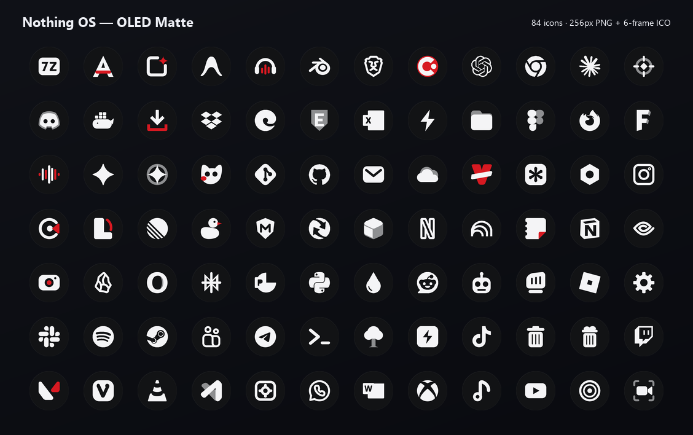
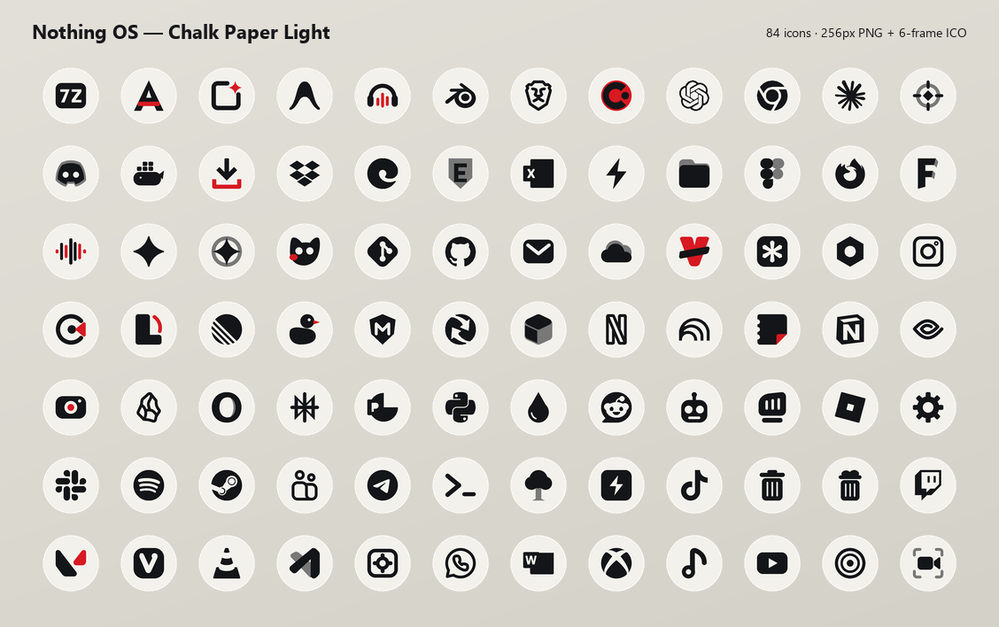

# Tema: Nothing OS (Dot-Matrix Hardware Style)

Suite nativa de Rainmeter inspirada en **Nothing OS**, con reloj matricial **5×7**, batería de **50 puntos** y modos **OLED, Chalk y AOD**. Las carátulas, los indicadores y los controles se dibujan con formas vectoriales.

## Widgets incluidos (`NothingZen`, 24 widgets)

| Categoría | Widgets |
| :--- | :--- |
| **Selector (1)** | `NothingSwitcher.ini` ofrece cinco acentos manuales, el acento del fondo, el modo, el idioma, la hora y la escala. |
| **Relojes (3)** | `NothingDotClock.ini`, `NothingAnalog.ini` y `NothingWorldClock.ini` (Husos y sus líneas de 24 horas). |
| **Calendario (1)** | `NothingCalendar.ini` muestra el mes completo y permite navegar entre meses. |
| **Sistema (4)** | `NothingTelemetry.ini` (historial de CPU y RAM), `NothingNetworkPulse.ini` (red), `NothingStorageBar.ini` (espacio libre) y `NothingRecStatus.ini` (arranque y tiempo activo). |
| **Batería y audio (4)** | `NothingBatteryDots.ini`, `NothingBatteryPill.ini` (Celdas), `NothingAudioCard.ini` (volumen) y `NothingEstereo.ini` (nivel RMS por canal). |
| **Música y enfoque (3)** | `NothingVinylPlayer.ini` (Pista), `NothingMusicMini.ini` y `NothingFocus.ini` (25 minutos de enfoque o 5 de descanso). |
| **Búsqueda, accesos y notas (3)** | `NothingSearchBar.ini` abre una consulta, `NothingQuickApps.ini` usa iconos de puntos y `NothingReminders.ini` pagina las notas. |
| **Señal (5)** | `NothingJornada.ini`, `NothingTrafico.ini`, `NothingMarcas.ini`, `NothingRespira.ini` y `NothingPunto.ini`. |

Pulsa **AUTO** en el selector para extraer el acento de la imagen de escritorio de Windows. Mientras el selector esté cargado, comprueba el color cada 45 segundos. Los fondos monocromos usan el rojo Nothing. Si Windows no ofrece una imagen legible, se usa el acento del sistema.

Haz clic en la escala para elegir **100 %, 125 %, 150 % o 200 %**. El menú también ofrece **ES / EN** y **12 h / 24 h**. En Notas, las flechas y la rueda recorren las entradas. **Editar** abre `@Resources/Reminders.txt`, con una nota por línea.

## Señal

Los cinco widgets se pueden cargar juntos en Rainmeter. Cada uno tiene su propia carpeta.

- **Jornada.** Pulsa `24 H` para ver cuánto falta para el inicio o el fin de tu turno. Ajusta `ShiftStart` y `ShiftEnd` en `@Resources/SignalState.inc` usando horas locales en formato de 24 horas. El turno puede cruzar medianoche.
- **Tráfico.** La matriz superior dibuja la descarga y la inferior la subida. Ambas comparten el máximo de la ventana visible. El botón cambia entre 30 y 60 segundos de historial local.
- **Marcas.** Registra una actividad por día. Pulsa de nuevo para deshacer la marca de hoy. El panel muestra los últimos siete días y guarda las marcas en `@Resources/SignalState.inc`.
- **Respira.** Guía visual de cuatro rondas. Cada ronda tiene cuatro segundos para inhalar, tres para sostener y cinco para exhalar. Pulsa el dial para comenzar o detener la guía.
- **Punto.** Espera el destello de la matriz y pulsa el widget. La latencia es aproximada y se redondea a 10 ms. La mejor marca se conserva durante la sesión del widget.

Las fichas oficiales de Nothing sirvieron como referencia de formas, lectura rápida y controles. [Nothing Widgets en Google Play](https://play.google.com/store/apps/details?id=com.nothing.hearthstone), [Nothing Community Widgets en Google Play](https://play.google.com/store/apps/details?id=com.nothing.communitywidgets)

## Packs de iconos (`168 iconos` — OLED Matte y Chalk Paper Claro)

Incluye **2 variantes completas de 84 iconos** estilo **Nothing OS** en **PNG (256×256)** e **ICO multirresolución (16–256px)** para Escritorio, Barra de Tareas y **Muelle**:
- **OLED Matte (`icons/nothing-mono/`):** círculos negro mate OLED con glifos blanco puro y acentos **Nothing Crimson Red**.
- **Chalk Paper Claro (`icons/nothing-chalk/`):** círculos papel tiza cálido (`#F2F1EC`) con glifos negro mate y acentos **Nothing Crimson Red**.

| Nothing OS — OLED Matte (84) | Nothing OS — Chalk Paper Claro (84) |
| :---: | :---: |
|  |  |

## Wallpapers compatibles (4K)

Puedes combinar la suite con cualquiera de los fondos del repositorio.
- **[Wallpapers One UI 4K (`36 fondos` — Claro y Oscuro)](../one-ui/wallpapers/veyra-oneui-wallpapers-4k/)**
- **[Wallpapers Material You 4K (`23 fondos`)](../material-you/wallpapers/)**

## Instalación rápida

- **Opción más fácil (1 clic, sin terminal):** descarga y haz doble clic en **[`NothingZen-v2.rmskin`](../../releases/NothingZen-v2.rmskin)**.
- **Por PowerShell (desde la raíz de `Veyra-Dots`):**
```powershell
.\scripts\install-rainmeter.ps1 -Theme nothing
```

Al actualizar desde el instalador, la opción de copia de seguridad de Rainmeter conserva `Variables.inc` y `SignalState.inc`, y guarda el `Reminders.txt` anterior en la copia de la suite.
